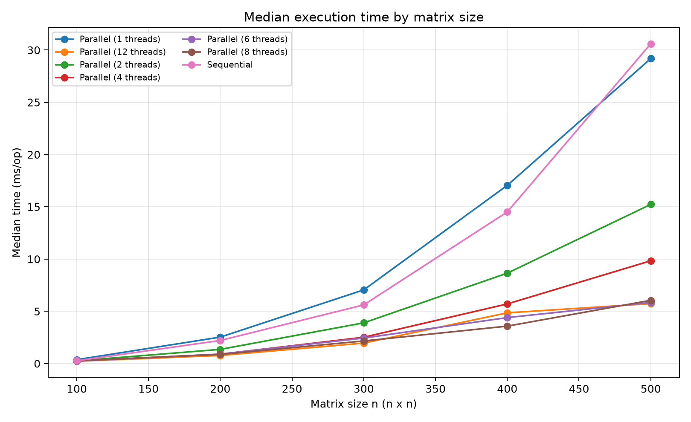
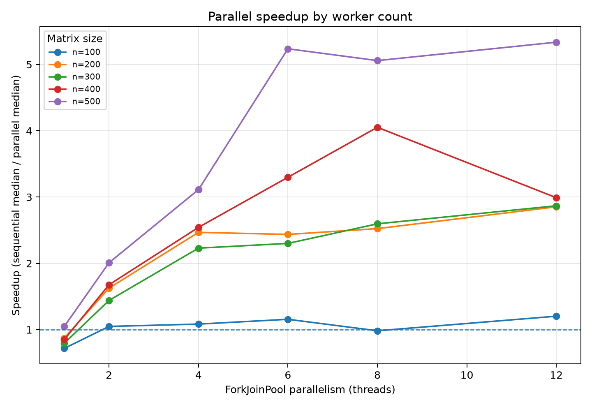
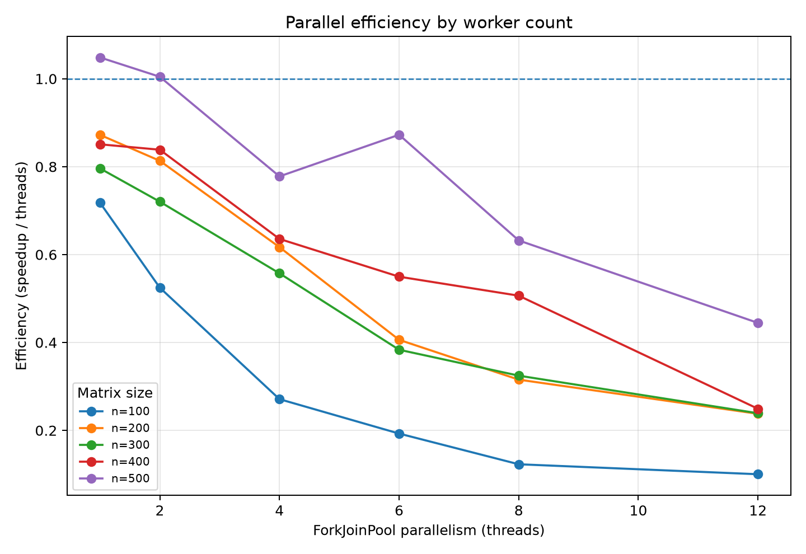
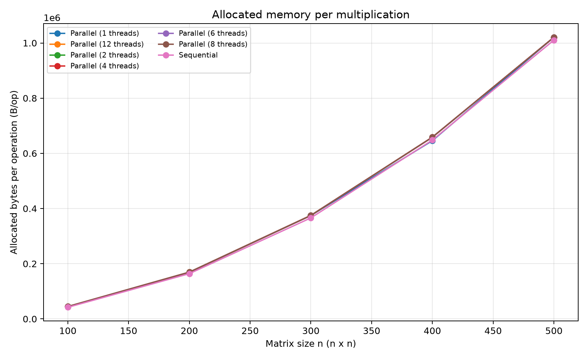

# Parallel Matrix Multiplication (Assignment 3)

**Course:** Big Data, academic year 2026-2027  
**Research title:** Parallel Matrix Multiplication
**Student:** Víctor Díaz Puga

## 1. Objective

This project studies how the worker-thread count affects shared-memory matrix multiplication. It compares an equivalent sequential and parallel implementation of the same `i-k-j` loop-reordered algorithm. Both implementations use Java `int[][]` matrices, integer arithmetic, the same generator, and identical inputs for each matrix size.

The optional SIMD vectorisation extension is not included. This keeps the experiment focused on parallel execution and thread-count scaling.

## 2. Reuse from Assignment 2

The sequential reference reuses the `multiplyLoopReordered` method and input-generation approach from the Assignment 2 repository:

<https://github.com/VictorDP17/Optimised-Matrix-Multiplication-Approaches-and-Sparse-Matrices>

The input generator uses Java `Random`, seeds `777` and `778`, and values from `0` to `99`, as in the dense Assignment 2 experiment. The parallel version preserves the same `i-k-j` arithmetic order within each output row; only the distribution of independent rows changes.

## 3. Implementations

- **Sequential reference:** `MatrixMultiplier.multiplyLoopReordered(A, B)`.
- **Parallel implementation:** `MatrixMultiplier.multiplyParallelLoopReordered(A, B, pool)` using a `ForkJoinPool` and recursively split row ranges.
- **Thread counts:** `1, 2, 4, 6, 8, 12`. These values follow the hardware recorded in the Assignment 2 report (6 physical cores and 12 logical processors). Verify the current machine before treating them as its final supported configurations.
- **Matrix sizes:** `100, 200, 300, 400, 500`.

Each task writes to a disjoint range of rows of the output matrix. The two input matrices are read-only during multiplication. Therefore, no two tasks write to the same output cell and no locks are required for the matrix calculation.

The benchmark harness always uses one JMH thread. `THREAD_COUNT` controls the separate `ForkJoinPool` parallelism, so the benchmark does not accidentally multiply the requested worker count by concurrent JMH invocations.

## 4. Requirements

- JDK 21.
- Maven (the Assignment 2 project used Maven 3.9.x).
- JMH 1.37 (declared in `pom.xml`).
- Python 3.10+ and Matplotlib for plotting.

Install Matplotlib if needed:

```powershell
python -m pip install matplotlib
```

## 5. Build and run

Open the project root (`Parallel-Matrix-Multiplication-and-Vectorisation`) in IntelliJ IDEA and set the Project SDK to JDK 21.

### 5.1 Compile

From the project root:

```powershell
mvn clean test-compile
```

### 5.2 Correctness checks

Run `benchmark.CorrectnessTest` as a Java application in IntelliJ IDEA. It checks:

- A known 2 x 2 product.
- Identity and zero matrix properties.
- Equality between the sequential and parallel results for the same generated matrices with `1, 2, 4, 6, 8` and `12` workers.

Expected output:

```text
All Assignment correctness checks passed.
```

Run these checks before benchmarking.

### 5.3 Run the full benchmark

Run `benchmark.BenchmarkMain` as a Java application. Set the run configuration's working directory to the project root so that output files are written here.

The full configuration uses:

- JMH mode: `AverageTime`, reported in milliseconds per operation.
- Warm-up: 1 iteration of 1 second.
- Measurement: 5 iterations of 1 second each.
- Forks: 1.
- JMH harness threads: 1.
- Parallel worker counts: `1, 2, 4, 6, 8, 12`.
- JMH `GCProfiler` for allocation (`gc.alloc.rate.norm`).

The input matrices and the `ForkJoinPool` are created in `@Setup(Level.Trial)`, outside the timed operation. The output matrix and the per-operation fork/join task objects are allocated during the timed operation. Thus, the allocation metric includes the output and task overhead but excludes the inputs and pool setup.

### 5.4 Generated files

The benchmark writes these files to the working directory:

- `results.csv`: summary data, including mean, median, variance, standard deviation, allocated bytes per operation, speedup and efficiency.
- `jmh_raw.json`: raw JMH result records. Keep this file with the submission.

The speedup and efficiency use the **median** time for the sequential reference and the corresponding parallel configuration.

The parallel one-worker result is retained. It reveals the overhead of the parallel framework even when no multi-worker scaling is available.

### 5.5 Generate plots

After running the full benchmark:

```powershell
python analysis/plot_results.py
```

The script creates four figures in `results/plots/`: execution time, speedup, efficiency, and allocated memory.

### Allocated Memory


### Allocated Memory


### Allocated Memory


### Allocated Memory


## 6. Environment

| Item | Value |
|---|---|
| Operating system and version | Windows 11 Home 25H2 |
| CPU model | 11th Gen Intel(R) Core(TM) i5-11400H @ 2.70GHz |
| Physical cores / logical processors | 6 / 12 |
| Installed RAM | 7,65 GB |
| Java JDK version | 21.0.12.1 |
| Python | 3.12.10 |
| JMH version | 1.37 |

## 7. CSV columns

| Column | Meaning |
|---|---|
| `method` | `sequential_loop_reordered` or `parallel_loop_reordered`. |
| `matrix_size` | Side length `n` of the square matrices. |
| `threads` | `ForkJoinPool` parallelism; the sequential reference is recorded as 1. |
| `numeric_type` | Java `int`. |
| `jmh_threads` | Number of concurrent JMH benchmark invocations; fixed at 1. |
| `warmup_iterations`, `measurement_iterations` | JMH iteration counts. |
| `mean_time_ms`, `median_time_ms` | Mean and median milliseconds per multiplication. |
| `variance_time_ms2`, `stddev_time_ms` | Variance and standard deviation of JMH primary-result samples. |
| `allocated_bytes_per_op` | Normalised allocated bytes per operation from `GCProfiler`; not peak resident memory. |
| `speedup` | Sequential median divided by parallel median for the same `n`. |
| `efficiency` | Speedup divided by the parallel worker count. |

## 8. Interpretation notes

- A speedup greater than 1 means the parallel result was faster than the sequential reference for that tested configuration.
- Efficiency is speedup divided by the configured worker count. It can fall as workers are added because of scheduling, task creation, memory bandwidth and imperfect load balance.
- The parallel method with one worker includes task-splitting and pool-dispatch overhead and is not expected to be identical to the sequential method.
- Allocated bytes per operation are not peak process memory and do not include the matrices and pool created during setup.
- Conclusions must be limited to the tested matrix sizes, worker counts, hardware, JVM and input data. Do not infer universal behaviour from one machine.
- If an unusual or superlinear speedup appears, inspect raw measurements, variance, warm-up and memory effects before interpreting it.

## 9. AI assistance disclosure

> **AI tool:** Chat GPT
>
> **Purpose:** Improve redaction, speed up code writing
>
> **Parts affected:** Different parts of the code, README and report
>
> **Validation:** The code was refactored and rewritten after use, the README and report were initially handwritten and then checked
